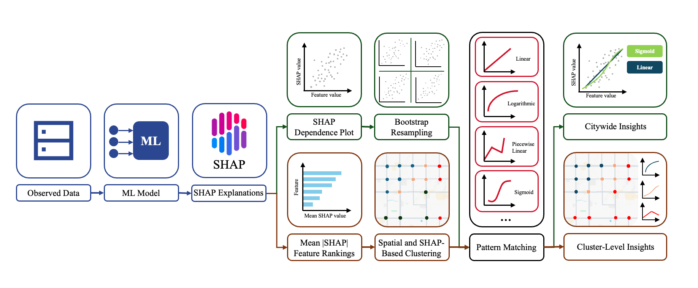
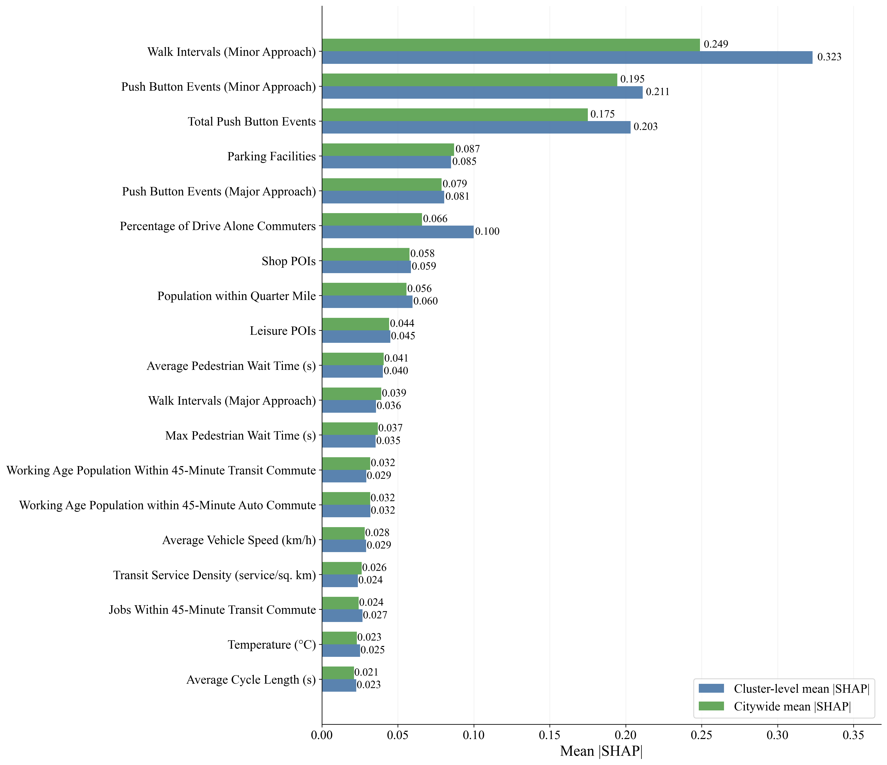
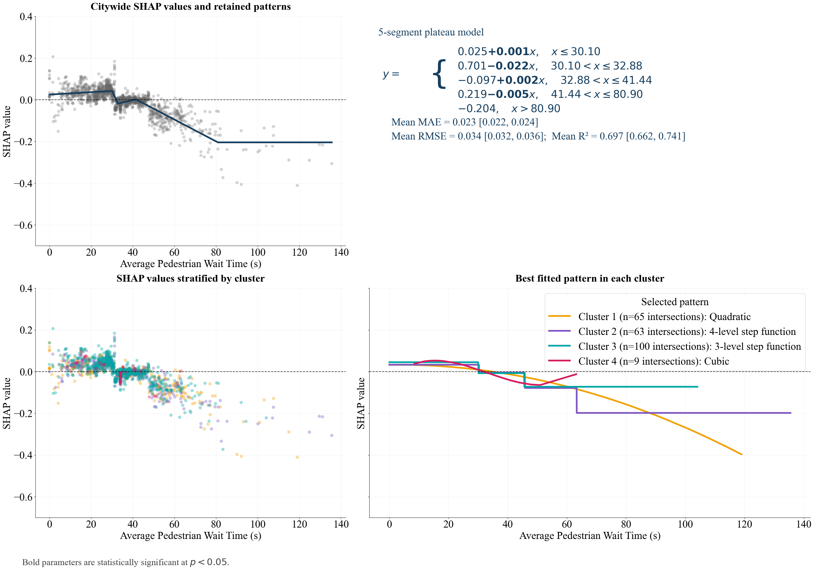
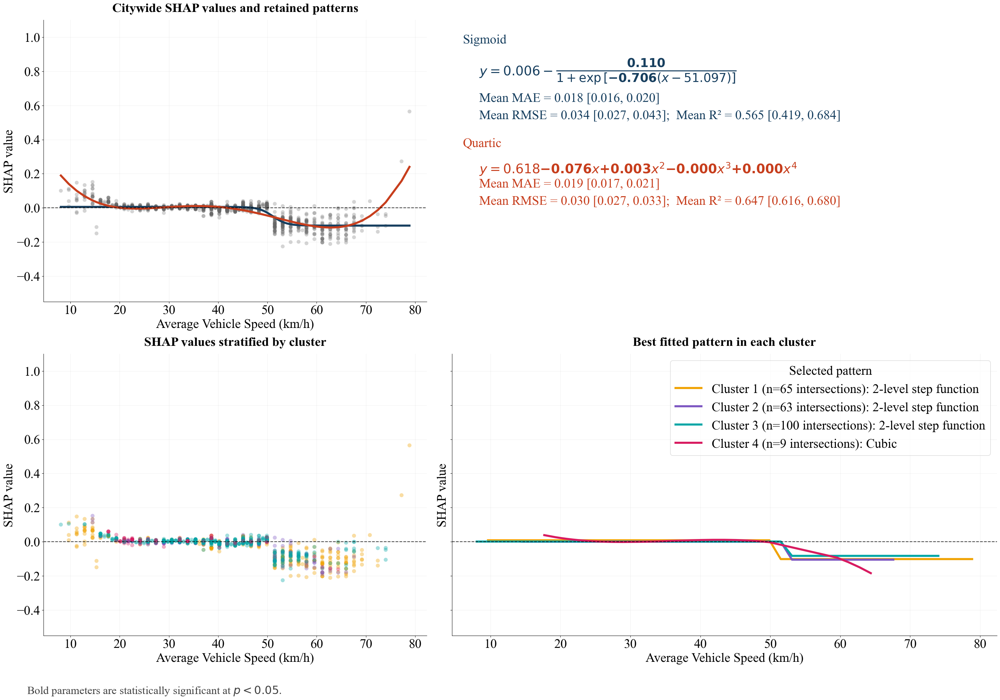

# Automated Decision Support Framework for Adaptive Pedestrian Planning

This repository provides an automated framework for identifying interpretable response patterns in machine-learning explanations. It fits and compares candidate functional forms to SHapley Additive exPlanations (SHAP) dependence values and reports their direction, shape, potential thresholds, and fit statistics. Citywide and cluster-level analyses help characterize relationships that vary across local conditions.

The implementation combines XGBoost modeling, SHAP-based feature ranking, context clustering, bootstrap assessment, and parsimonious pattern selection. A pedestrian-activity case study from Tucson, Arizona, demonstrates its application to 1,708 intersection-hour observations at 237 signalized intersections.

## Framework overview

<p align="center">
  
</p>

The automated workflow:

1. Receives and validates a pedestrian activity dataset.
2. Selects XGBoost hyperparameters, evaluates predictive performance, and computes SHAP values.
3. Selects influential clustering features from drops in ranked mean absolute SHAP importance.
4. Groups intersections using their locations and selected predictors, choosing the cluster count by silhouette score.
5. Fits candidate response patterns to aggregate and cluster-stratified SHAP dependence values.
6. Exports selected forms, equations, thresholds, uncertainty summaries, diagnostic tables, and figures.

## Repository structure

| File or directory | Description |
|---|---|
| `pedestrian_framework.py` | Automated modeling, SHAP analysis, clustering, pattern selection, and result export |
| `pedestrian_patterns.py` | Candidate functional forms, fitting routines, and conditional parameter diagnostics |
| `pedestrian_figures.py` | Visual representation of pattern panels, SHAP rankings, cluster maps, and importance plots |
| `framework_config.json` | Paths, model search space, validation settings, clustering rules, and pattern-selection controls |
| `Pedestrian_model_patterns.ipynb` | Tucson case study: selected model, context groups, bootstrap analysis, and response-pattern figures |
| `Input_Data/final_pedestrian_data.csv` | Prepared case-study dataset |
| `Images/` | Framework overview and selected example figures |

The Python framework is configured for automated analysis of prepared datasets. The pattern notebook provides a self-contained case-study analysis with specified model parameters, feature selections, and visualization settings.

## Installation

Use Python 3.10 or newer. From the repository directory:

```bash
python -m venv .venv
source .venv/bin/activate
pip install -r requirements.txt
```

On Windows, activate the environment with `.venv\Scripts\activate`.

The case-study notebook uses Contextily for basemap tiles. The automated framework produces maps from projected coordinates without downloading basemap tiles. Each automated run records its installed package versions in `run_summary.json`.

## Running the framework

```bash
# Run with reduced settings.
python pedestrian_framework.py --quick

# Analysis using the settings in framework_config.json.
python pedestrian_framework.py

# Analysis using a separate configuration and output directory.
python pedestrian_framework.py --config analysis_config.json --output-dir Outputs/analysis
```

The quick run uses one hyperparameter-search trial, two validation folds, two ranked features, five curve-bootstrap resamples, and up to three segments. Use the full configuration for substantive analysis. See [Input data and configuration](#input-data-and-configuration) for input requirements and configuration settings.

Configuration paths are resolved relative to the configuration file. An explicit `--output-dir` is resolved relative to the working directory. The default destination is `Outputs/framework/`. Each successful run replaces the previous framework results in that same directory. A failed run leaves the previous results intact. Directories without a framework manifest are never replaced.

## Input data and configuration

Supply a CSV containing the five required columns: `DeviceID` (intersection identifier), `DateHour` (observation timestamp), `Latitude`, `Longitude`, and `HourlyPedCount` (nonnegative pedestrian count). All remaining columns are treated as numeric predictors. The identifier, timestamp, and coordinates are excluded from model predictors; the identifier and coordinates support intersection-level grouping and geographic clustering. Column order and dataset dimensions are read directly from the CSV; no separate schema file is required.

Predictors must have meaningful names and consistent units before analysis. Complete categorical encoding and source-data integration upstream. Missing numeric values are mean-imputed within each training split for evaluation; the final explanatory model is fitted to all observations.

| Configuration section | Settings |
|---|---|
| `model` | Objective, randomized-search space, trial count, test fraction, validation folds, and baseline comparisons |
| `clustering` | Importance-gap search range, minimum drop, fallback count, stability resamples, cluster range, and geographic weighting |
| `patterns` | Number of ranked features, candidate limits, segment support, breakpoint grid, bootstrap controls, and MAE tolerances |
| `figures` | Figure generation, resolution, and number of displayed features |

Paths and random seeds are configured at the top level. Selected model hyperparameters are saved with each run.

The feature-selection and clustering methods are documented at the beginning of `pedestrian_framework.py`; candidate functions and pattern-selection methods are documented at the beginning of `pedestrian_patterns.py`.

## Results

Results are written to `Outputs/framework/`. Supporting tables are saved alongside a `figures/` directory containing exactly these figure types:

- `shap_ranking.png`: top-N citywide mean absolute SHAP importance.
- `shap_ranking_by_cluster.png`: citywide and equal-weight cluster-average importance.
- `clusters.png`: intersection context groups.
- `feature_importance_drop.png`: importance ranking and the selected clustering-feature cutoff.
- `patterns/<feature>.png`: one four-panel comparison for each of the top-N features, showing citywide fits, equations and bootstrap statistics, cluster-stratified SHAP values, and selected cluster fits.

`patterns.top_n` controls the feature count for both the pattern plots and the ranking plots. Figure typography, colors, markers, and line widths follow the case-study pattern notebook. The map uses the notebook's marker styling and northern viewport crop. It is generated offline by default; `figures.basemap` optionally enables a grayscale base layer, and `figures.map_crop_top_fraction` controls the viewport crop. Silhouette scores are retained in `run_summary.json`.

Supporting results are consolidated into six files:

| File | Contents |
|---|---|
| `run_summary.json` | Configuration, selected model parameters, best search score, clustering decision and silhouette comparisons, feature-selection stability summary, provenance, and completion status |
| `model_evaluation.csv` | Held-out and cross-validation metrics, including baseline comparisons when enabled |
| `feature_summary.csv` | Citywide and cluster-level SHAP importance, importance gaps, selected clustering features, and selection frequencies |
| `clusters.csv` | One row per intersection with coordinates, selected predictor means, and cluster assignment |
| `patterns.csv` | Retained citywide and cluster patterns, equations, coefficients, direction, thresholds, full-data fit metrics, and citywide bootstrap summaries |
| `parameter_tests.csv` | Conditional parameter and contrast tests for the retained patterns |

`Full-data` fit metrics describe the final fitted curves. `Bootstrap` metrics describe the resampling distribution used for citywide selection; cluster fits do not use bootstrap intervals. Detailed bootstrap replicates, unselected candidate fits, repeated ranking tables, observation-level cluster duplicates, model binaries, and raw SHAP arrays are not saved. The saved settings, seeds, selected parameters, and input fingerprint support rerunning the analysis. Observation cluster labels can be recovered by joining the input intersection identifier to `clusters.csv`.

Generated framework results are excluded from version control. Selected study tables and figures can be shared separately in `Outputs/` and `Images/`.

## Example: Pedestrian activity in Tucson

The Tucson application uses 1,708 intersection-hour observations from 237 signalized intersections. The prepared dataset combines pedestrian counts with traffic operations, built-environment, mobility, demographic, and environmental predictors.

The case-study analysis is available in [Pedestrian_model_patterns.ipynb](Pedestrian_model_patterns.ipynb). It includes the specified XGBoost model, four context groups, ten selected determinants, bootstrap comparisons, and citywide and cluster-level response patterns. Run the notebook cells in order from the repository directory; stored outputs can also be viewed directly.

<p align="center">
  
</p>

Citywide and cluster-level patterns describing the relationships between pedestrian activity, pedestrian wait time, and vehicle speed are shown in the following figures.

<p align="center">
  
  
</p>

The application accompanies *A Reusable and Automated Decision-Support Framework for Adaptive Pedestrian Planning: Identifying Nonlinear and Context-Dependent Pedestrian Activity Response Patterns*.

## Contact and acknowledgements

Contact [shamshiripour@arizona.edu](mailto:shamshiripour@arizona.edu) or [danialchekani@arizona.edu](mailto:danialchekani@arizona.edu).

We thank the Pima Association of Governments, City of Tucson, Arizona Department of Transportation, Center for Applied Transportation Sciences, and Dr. Xiaofeng Li for data access, support, and comments. The opinions and findings are those of the authors and do not necessarily reflect PAG's views.
