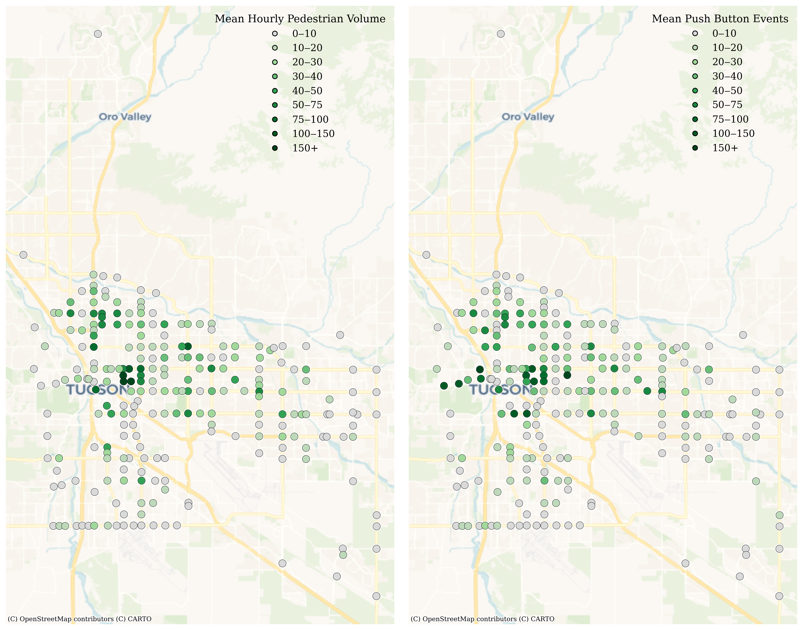
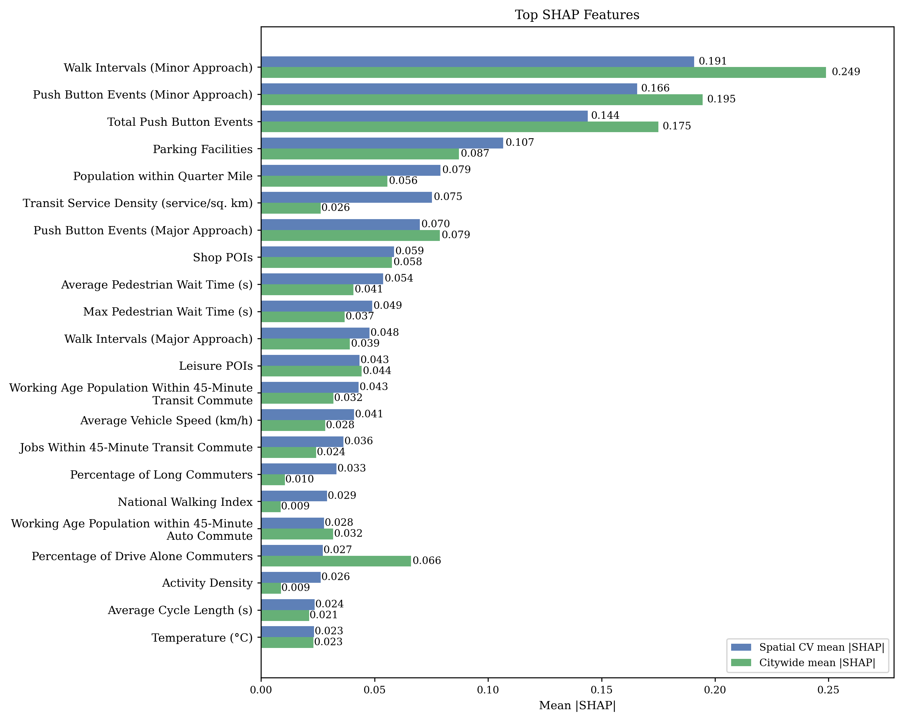
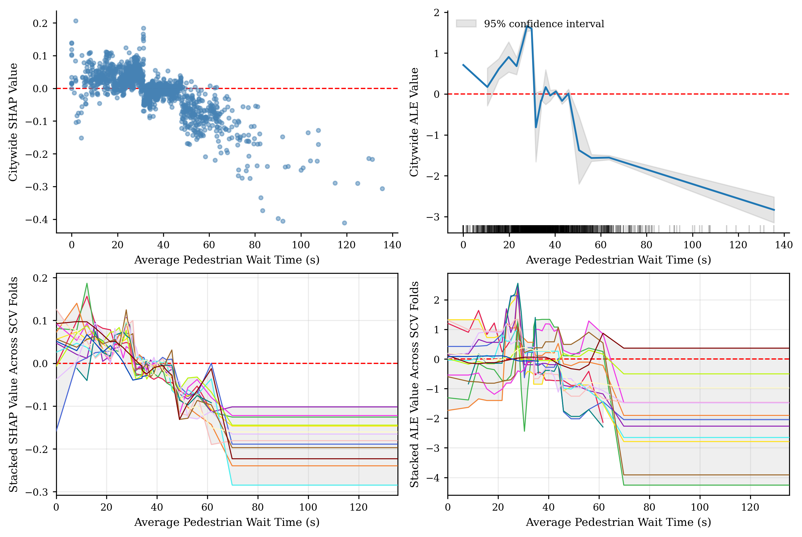

# Pedestrian_Volume_Estimation

This repository contains the full modeling and data processing workflow for estimating hourly pedestrian volumes at signalized intersections using signal operations data (push-button events and related timing features) combined with built-environment, mobility, demographic, and environmental covariates.

The project integrates static and time-varying predictors (200+ features) to improve pedestrian volume estimation beyond push-button counts alone.

Data sources include:

- **American Community Survey (ACS)**  
  Block group–level demographic and socioeconomic context (NHGIS 5-year estimates).

- **MaxView (event-based)**  
  High-resolution signal operations data, including push-button activation events.

- **Meteostat**  
  Weather observations (e.g., temperature).

- **INRIX Speed Data**  
  Average vehicle speeds near study intersections.

- **Environmental Protection Agency (EPA)**  
  Smart Location Database indicators (e.g., activity density, national walking index, transit service density).

- **Pima Association of Governments (PAG)**  
  Employment and land-use related contextual data.

- **OpenStreetMap (OSM)**  
  Built environment characteristics extracted within a 400-meter buffer (e.g., points of interest, sidewalk presence).

- **Tree Equity Score (TES)**  
  Urban greening and tree canopy coverage indicators.

---

## Repository Structure

```
Pedestrian_Volume_Estimation/
│
├── Pedestrian_model_clean.ipynb
│
├── Output/                               
│   ├── final_pedestrian_data.csv
│
├── Images/
│   ├── Figure_1.png
│   ├── Figure_2.png
│   └── ...
│
├── requirements.txt
└── README.md
```

---

## Project Overview

This repository contains the following notebook:

### `Pedestrian_model_clean.ipynb`

Contains the full modeling and evaluation workflow. It produces:

- Model training and validation
- Model comparisons across baselines
- SHAP-based feature importance analysis
- Accumulated Local Effects (ALE) analysis
- Scenario analysis
- All figures and analytical outputs reported in the project

---

## Installation

To use this project, you need to have Python installed on your system. You can download Python from the [official Python website](https://www.python.org/downloads/).

Once you have Python installed, you can install the required dependencies using pip. Run the following command in your terminal or command prompt:

```bash
pip install -r requirements.txt
```

---

## Reproducing Results

1. Run `Pedestrian_model.ipynb` to train models, evaluate performance, and generate outputs.

Execution time may vary depending on dataset size and hardware.

---

## Selected Visuals

<div style="text-align:center;margin-top:2rem;margin-bottom:2rem">

</div>


This figure visualizes hourly pedestrian volumes alongside hourly push-button events at study intersections. It highlights the locations of devices and range of hourly pedestrian volumes and push-buttons.

---

<div style="text-align:center;margin-top:2rem;margin-bottom:2rem">

</div>


This figure presents the top-ranked features using mean absolute SHAP values, comparing citywide importance with context-dependent importance averaged across spatial folds.

---

<div style="text-align:center;margin-top:2rem;margin-bottom:2rem">

</div>

This visualization shows the relationship between pedestrian activity and wait time, with citywide results indicating a decline in walking once delays exceed ~40 seconds. Context-dependent SHAP patterns remain stable between 15–60 seconds, where most observations occur, while ALE results exhibit greater variability, suggesting strong interactions with other model features.

---

## Data Availability

Processed datasets used for modeling have been made publicly available.

However, the raw data sources and data processing codes are not included in this repository due to usage restrictions.

---

## Contact
For questions or feedback, please email [danialchekani@arizona.edu](mailto:danialchekani@arizona.edu) or [danialchekani2000@gmail.com](danialchekani2000@gmail.com)

## Contributions
- **Danial Chekani**: Developed the full data processing and modeling pipeline, implemented all code, performed analysis, and generated figures and outputs.

- **Dr. Ali Shamshiripour**: Provided research supervision and methodological guidance, and contributed feedback through review and editing.

- **Dr. Jun Zhao**: Supported data-related investigation and provided input during dataset development.

- **Dr. Hyunsoo Noh**: Assisted with data investigation and offered supervisory feedback during project development.

- **Dr. Yao-Jan Wu**: Provided project-level administrative oversight.

## Acknowledgements

We would like to thank the Pima Association of Governments (PAG) and the City of Tucson for providing access to the pedestrian, signal, and employment data used in this study. Appreciation is also extended to the Arizona Department of Transportation (ADOT) and the Center for Applied Transportation Sciences (CATS) for supporting this work by providing access to crash data and speed data, and to Dr. Xiaofeng Li for his comments on the project. The opinions, findings, and conclusions in this paper are solely those of the authors and not necessarily those of PAG.
